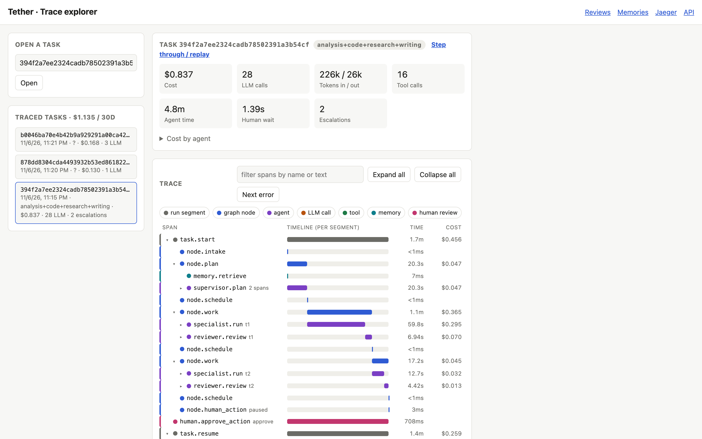
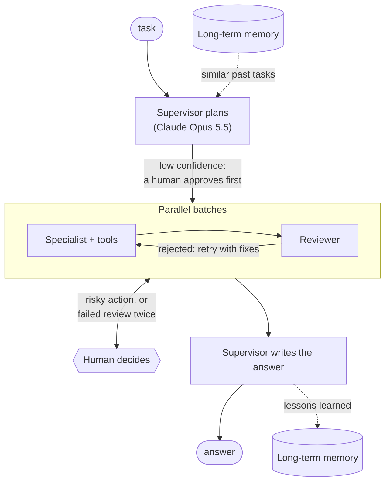
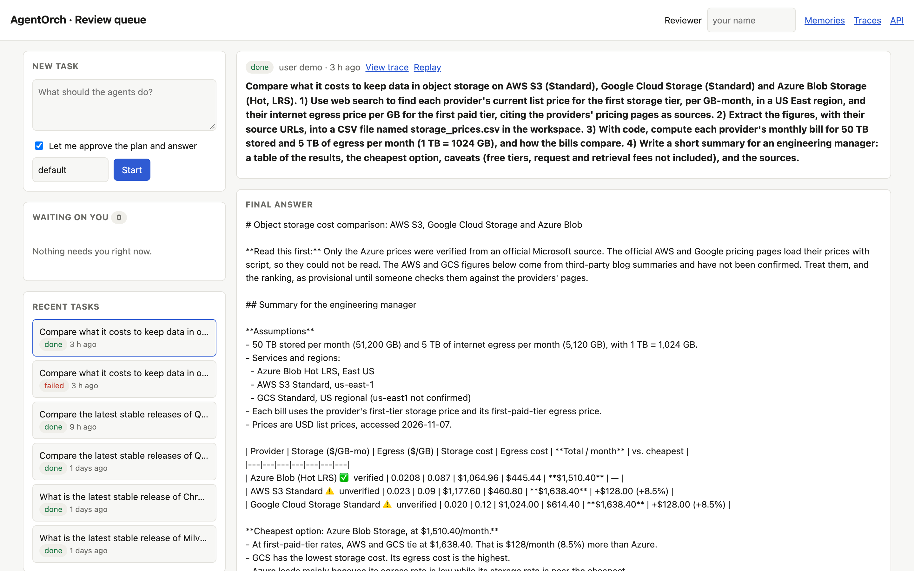
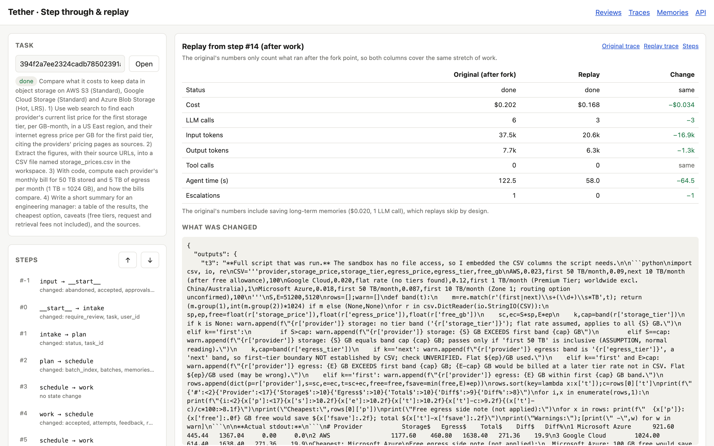
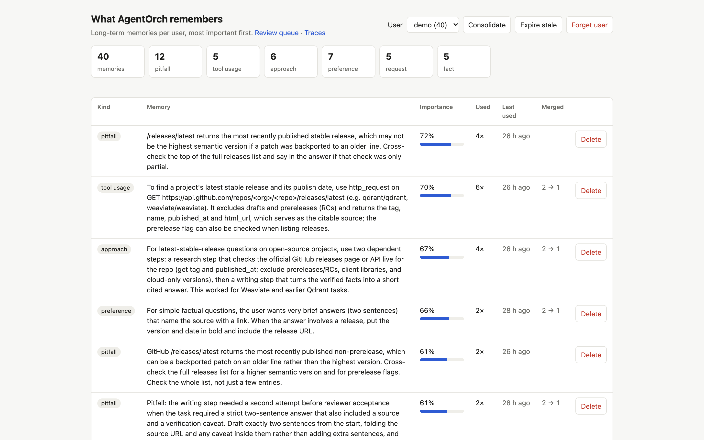

# AgentOrch

**A multi-agent orchestration system with tool use, persistent memory, and human-in-the-loop review.**


[](https://github.com/contract-s/AgentOrch/actions/workflows/ci.yml)

You give AgentOrch a task in plain language. A **supervisor agent** turns it into a plan
of subtasks, **specialist agents** carry out the subtasks with real tools, and a
**reviewer agent** checks every result before it is used. The system **remembers** what
worked for the next task, **stops for a human** when confidence is low or an action is
risky, and **records every step**, so any run can be inspected, costed and replayed with
changes.



## Contents

- [What it does](#what-it-does)
- [How it works](#how-it-works)
- [Dashboards](#dashboards)
- [Quick start](#quick-start)
- [Configuration](#configuration)
- [API](#api)
- [Testing](#testing)
- [Results](#results)
- [Challenges and what I learned](#challenges-and-what-i-learned)
- [Limitations and next steps](#limitations-and-next-steps)
- [Project layout](#project-layout)
- [Tech stack](#tech-stack)
- [Author](#author)

## What it does

- **Plans.** Claude Opus 5.5 breaks a request into subtasks with dependencies, inputs,
  expected outputs and complexity. Plans are validated, and independent subtasks run in
  parallel.
- **Uses tools.** Four specialists (research, analysis, writing, code) work with web
  search, HTTP, a shared file workspace, a sandboxed Python runner, read-only SQL and a
  shared notes board. Every tool call goes through one registry that checks permissions
  and rate limits, and logs the call.
- **Reviews its own work.** A separate reviewer agent checks each result against the
  evidence from the tool calls. A rejected result is retried with specific fixes. A
  result that fails twice goes to a human.
- **Remembers.** After each task, the system saves lessons to long-term memory: what
  worked, what failed, how a tool was best used, and user preferences. The next similar
  task is planned with them. Memories gain importance with use, decay without it, and
  near-duplicates get merged.
- **Asks a human.** It pauses for a low-confidence plan, a sensitive action (like
  overwriting a file), repeated failure, or when you ask to approve the plan and answer
  yourself. Paused runs survive restarts.
- **Shows its work.** Every task is one OpenTelemetry trace: each LLM call with its
  prompt, response, tokens and cost, each tool call, and each human wait.
- **Replays.** You can step through any finished run, fork it from any step with edits
  (a different plan, output, guidance or task), and compare the result with the
  original.
- **Survives failure.** State is checkpointed after every step. Celery workers can be
  killed mid-run, and the run carries on elsewhere. A crashed run can be retried without
  redoing finished work. Each specialist attempt has a spending limit.

## How it works



The workflow is a LangGraph state machine with a scheduling hub. The hub runs every
subtask that is ready, sends rejected ones back with the reviewer's feedback, and
routes to a human step when needed. Human steps are LangGraph interrupts: the run is
checkpointed to Postgres and holds no resources while it waits.

In the full deployment, the API only records tasks and decisions. It hands each piece
of work to Celery workers through Redis:

| Service | Role |
|---|---|
| API (FastAPI) | Tasks, reviews, memory, traces and replay, plus the dashboards |
| Worker (Celery) | Runs the agents |
| Postgres | Checkpoints, tasks, reviews, replays, trace spans |
| Redis | Task queue, per-task working memory |
| ChromaDB | Long-term memories |
| Jaeger | Optional trace browser |

**More detail:** [docs/ARCHITECTURE.md](docs/ARCHITECTURE.md) covers every component,
with diagrams, measurements and the design decisions behind them.

## Dashboards

All four dashboards are plain HTML pages served by the API.

**Review queue** (`/dashboard/reviews`). Start tasks, follow their progress, and decide
on anything waiting for you. Each review shows the plan, the proposed action and the
agent's reasoning, the memories used, and past decisions. You can also chat with an
agent about the review before deciding.



**Trace explorer** (`/dashboard/traces`). The span tree of any task, color-coded by kind,
with timelines, cost per span and per agent, and the full prompts, responses and tool
inputs and outputs. The screenshot is at the top of this page.

**Step through and replay** (`/dashboard/replay`). Walk through a run's checkpoints and
see what each step changed. Fork from any step with edits, then compare the replay with
the original: cost, calls, time, outputs, and a diff of the final answer.



**Memory** (`/dashboard/memories`). Everything the system remembers about each user,
ranked by importance, with usage counts. From here you can merge near-duplicates,
expire stale memories, and delete individual memories or everything for a user.



## Quick start

You need Docker and an [Anthropic API key](https://console.anthropic.com/).

```bash
git clone https://github.com/contract-s/AgentOrch.git
cd AgentOrch
cp .env.example .env    # then set ANTHROPIC_API_KEY
make stack              # builds and starts the API, worker, Postgres, Redis, ChromaDB, Jaeger
```

Open http://localhost:8000 and start a task from the review queue, or run the showcase
demo from a terminal:

```bash
make demo                                    # watch it run, approve reviews in the dashboard
uv run python scripts/demo.py --auto         # approve any review from the terminal
uv run python scripts/demo.py --review       # you approve the plan and the final answer
```

The demo task compares object-storage costs on AWS, Google Cloud and Azure. It runs
research, then extraction into a CSV, then analysis with code, then a summary. It takes
about 4–5 minutes and costs about $1.10.

### Local development

Run the infrastructure in Docker and the API on your machine, with hot reload. Runs
execute inside the API process.

```bash
make install    # uv sync (needs uv and Python 3.11)
make up         # Postgres, Redis, ChromaDB, Jaeger
make api        # http://localhost:8000
make worker     # optional: a local Celery worker (then set TASK_RUNNER=celery in .env)
```

## Configuration

Set these in `.env`. [.env.example](.env.example) lists them all.

| Variable | Default | What it does |
|---|---|---|
| `ANTHROPIC_API_KEY` | (required) | Claude API key |
| `SUPERVISOR_MODEL` | `claude-opus-5-5` | Model for planning and the final answer |
| `SPECIALIST_MODEL`, `REVIEWER_MODEL` | `claude-sonnet-5-5` | Models for specialists, and for the reviewer |
| `TASK_RUNNER` | `thread` (`celery` in Docker) | Where runs execute |
| `SPECIALIST_BUDGET_USD` | `0.40` | Model spend per specialist attempt before its tools are switched off |
| `PLAN_CONFIDENCE_THRESHOLD` | `0.7` | Plans below this confidence wait for a human |
| `REVIEW_QUALITY_THRESHOLD` | `0.7` | The reviewer's minimum quality score |
| `MAX_SPECIALIST_RETRIES` | `2` | Attempts per subtask before a human takes over |
| `REVIEW_WEBHOOK_URL` | (empty) | Slack-style webhook notified when a review is waiting |
| `OTEL_EXPORTER_OTLP_ENDPOINT` | (empty) | Also send traces to Jaeger or another OTLP collector |

## API

Interactive docs are at http://localhost:8000/docs. The main endpoints:

| Endpoint | Purpose |
|---|---|
| `POST /tasks` | Start a task (`task`, `user_id`, `require_review`) |
| `GET /tasks/{id}` | Status, plan, per-subtask progress, escalations, final answer |
| `POST /tasks/{id}/retry` | Continue a failed run from its last checkpoint |
| `GET /reviews`, `POST /reviews/{id}/decision` | The review queue, and deciding on a review |
| `POST /reviews/{id}/ask` | Ask an agent about a review before deciding |
| `GET /tasks/{id}/trace`, `GET /tasks/{id}/cost` | A task's span tree, and its cost breakdown |
| `GET /metrics` | Cost by task type and agent, tool error rates, escalation rate |
| `GET /tasks/{id}/steps`, `POST /tasks/{id}/replay` | Step through a run, and fork it with changes |
| `GET /replays/{id}/compare` | A replay against its original |
| `GET /users/{id}/memories`, `POST /users/{id}/memories/consolidate` | Inspect and manage memory |

## Testing

```bash
make test        # 139 unit tests with a fake model; no services, no cost (~10 s)
make e2e         # 5 tests on real Postgres, Redis, ChromaDB and Celery, with a scripted model (needs `make up`)
make e2e-live    # plus 5 tests against Claude (about $0.75)
```

- **Scripted end-to-end tests** run the whole system through the HTTP API. They cover:
  a task surviving a restart, a review that waits across a restart, memory carrying
  over to the next task, retrying a crashed run, and runs going through a real Celery
  worker.
- **Live tests** check behaviour that should hold on any good run:
  - the showcase task gets a valid plan in the right order;
  - a specialist uses the sandbox and gets a calculation right;
  - the reviewer blocks a wrong total and passes the right one;
  - a file overwrite waits for approval before anything is written;
  - a remembered preference changes the next plan.

## Results

The showcase run on the full Docker stack:

| | |
|---|---|
| Outcome | Done. 4 subtasks: research → CSV extraction → calculation in code → summary |
| Time | 275 s |
| Cost | $1.10: specialists $0.41, web search $0.34, reviewer $0.19, supervisor $0.15, memory $0.02 |
| Model calls | 29 (352k input and 27k output tokens), plus 21 tool calls |
| Human reviews | 2. Research failed review twice; writing the CSV file needed approval |

The answer was honest about its sources. AWS's and Google's pricing pages load their
prices with JavaScript, so the agents couldn't read them. The answer marks those two
providers' prices as unverified third-party figures. Azure's came from Microsoft's
official price API.

Replays are cheap. Forking a finished run just before its last subtask, with one output
edited, cost $0.026, against $0.043 for the same steps in the original.

## Challenges and what I learned

**A research agent that wouldn't stop.** The first full demo run spent **$2.71** and never
finished its first subtask. The research specialist found AWS's raw price list, a
file of several megabytes, and paged through it with 22 HTTP requests. Every turn resent all
earlier results to the model, so each call was bigger than the last. The trace explorer
showed exactly where the money went. **The fix:**
- each specialist attempt now has a spending limit, after which its tools are switched
  off and it must answer with what it has;
- tool results are cut at 12,000 characters;
- the agents are told to prefer focused searches over raw data.

The finished run then cost $1.10. **Lesson:** agent loops need budgets, not only turn
limits.

**Making the reviewer useful, not just strict.** Early reviewers rejected good work for
style, and also blocked claims they couldn't verify, because they saw only the first 4k
characters of each tool result. **The fixes:**
- verdicts now separate *blocking issues*, the only thing that fails a subtask, from
  *suggestions*;
- the reviewer sees the same evidence the specialist saw, and gets the outputs of
  earlier subtasks too.

**Running a risky action exactly once.** A sensitive tool call has to wait for a human.
Once approved, it must run exactly once, even though the run is paused, checkpointed and
resumed in between. The specialist finishes what it can without the call, and the
subtask is held. Approval pre-authorizes that exact call, and the subtask re-runs so the
specialist makes it and uses the result. Escalation ids are deterministic, so a resumed
node matches its review.

**Calibrating memory retrieval.** All-MiniLM-L6-v2 puts related memories at a cosine
distance of about 0.45–0.66, so retrieval uses a cutoff of 0.7. Then a live test failed.
"Start every summary with a TL;DR" sat at 0.68 from an unrelated summary task, so whether
it was found depended on how the model happened to word it. Preferences apply across topics, so
they now get a looser cutoff (0.85). The merge thresholds for consolidation were
measured on real memories the same way. **Lesson:** embedding thresholds have to be
measured per kind of content, not guessed.

**At-least-once delivery.** Celery with late acknowledgement redelivers a killed
worker's run. That's good for recovery, but only if running the same message twice is
harmless. Every run is now a JSON payload: start, resume a decision, or continue. The
runner always continues from the checkpoint, ignores a decision it has already applied,
and does nothing for a finished run.

**One trace across pauses, restarts and workers.** A run can pause for days and resume
in a different process. The trace id is the task id, and the root span is deterministic,
so every segment joins the same trace. Pauses also had to be recorded as paused, not as
errors.

**Fair replay comparisons.** The first comparison view made replays look cheaper than
they were. It counted only the original's work after the fork point, which was right,
but that work included the memory-saving call that replays skip by design. The view now
shows the memory cost separately, so the two columns compare like with like. A related bug: forking from before planning dropped the
memories the original had planned with. They now come from the original's final state.

**Smaller things that cost time:**
- A strict tool-input schema can't contain free-form maps, so HTTP headers became a list
  of name/value pairs.
- Two containers raced to fill the same new Docker volume from the image.
- Concurrent first requests raced to build the services, until the app built them at
  startup.
- LangGraph warns about checkpoint types it doesn't know, and will eventually refuse to
  load them, so ours are now registered.

## Limitations and next steps

- **No authentication** on the API or the dashboards.
- **No cancel button.** A running task can only be stopped by the spending limit or by
  hand.
- **Docker socket access.** The worker uses the host's Docker socket to start code
  sandboxes, which is root-equivalent on the host. A remote sandbox service would
  remove that.
- **No database migrations.** Tables are created at startup, so a schema change to an
  existing table needs a manual migration (Alembic is installed but not wired up).
- **Claude only.** The model-routing layer is ready for other providers, and OpenAI is
  next. MCP tool servers aren't supported yet.

## Project layout

```
src/agentorch/
  agents/          supervisor, specialists, reviewer, plan validation
  graph/           LangGraph workflow and wiring
  tools/           tool registry and the built-in tools
  memory/          working (Redis) and long-term (ChromaDB) memory, scoring, consolidation
  hitl/            escalation rules, review queue, task service, notifier, review assistant
  observability/   tracing, span store, cost model, metrics
  replay.py        step-through, fork and compare
  api/             FastAPI routes; static/ holds the four dashboards
  workers/         Celery worker
scripts/           demo and command-line runners
tests/unit/        fast tests with a fake model
tests/e2e/         tests on real infrastructure (scripted model, and live)
docs/              architecture, demo video script, roadmap
```

## Tech stack

| Area | Choice |
|---|---|
| Language | Python 3.11, managed with uv |
| Orchestration | LangGraph, with the Postgres checkpointer |
| Models | Claude Opus 5.5 (supervisor), Claude Sonnet 5.5 (everything else), via the Anthropic SDK |
| API | FastAPI and pydantic v2 |
| Async execution | Celery on Redis |
| Storage | Postgres (SQLAlchemy 2.0), Redis, ChromaDB |
| Observability | OpenTelemetry → Postgres span store and Jaeger |
| Sandbox | Throwaway Docker containers with no network and a read-only filesystem |
| Deployment | Docker Compose |
| Quality | pytest, ruff |

See [docs/ROADMAP.md](docs/ROADMAP.md) for how the build progressed, phase by phase.

## Author

**Sai Siddharth Kodali**

Built with the help of [Claude Code](https://claude.com/claude-code).
