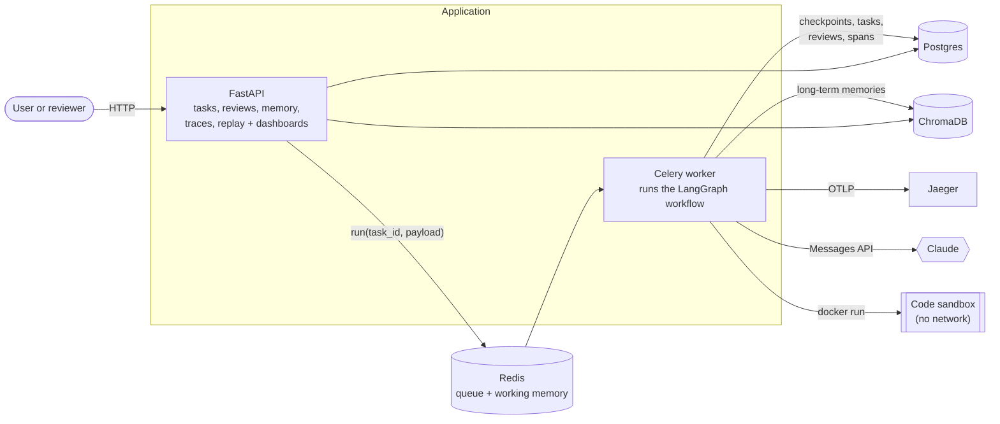
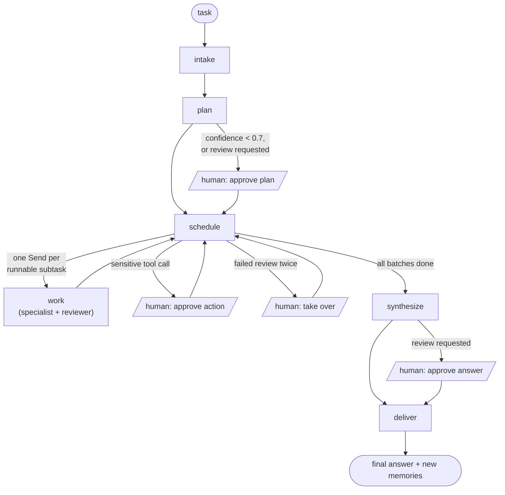
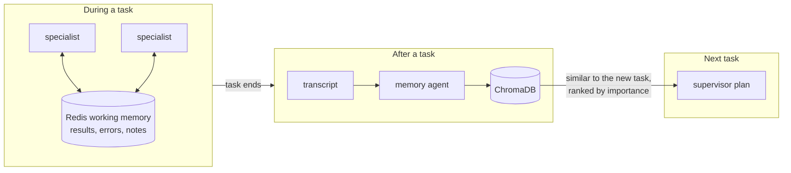

# AgentOrch architecture

AgentOrch takes a task in plain language, has a supervisor agent break it into a plan of
subtasks, runs those subtasks with specialist agents that use tools, checks each result
with a reviewer agent, and writes a final answer. Along the way it remembers what it
learned for next time, stops for a human when it should, and records every step so a run
can be inspected, costed and replayed.

This document covers how the parts fit together, why they are built the way they are,
and what the system has been measured to do.

## The system at a glance

| Part | What it holds or does |
|---|---|
| **API** (`api/`) | Accepts tasks and review decisions, and serves the dashboards. With `TASK_RUNNER=celery` it never runs agents itself. |
| **Worker** (`workers/`) | Runs workflow steps it receives from Redis. It can be scaled out and safely killed. |
| **Postgres** | LangGraph checkpoints (the full run state after every step), plus task, review, replay and span tables. |
| **Redis** | The Celery queue, and per-task working memory shared by parallel specialists. |
| **ChromaDB** | Long-term memories per user, embedded with all-MiniLM-L6-v2. |
| **Jaeger** | An optional second home for traces. The trace explorer reads from Postgres. |

In development, `make api` runs everything in the API process on a thread pool instead.
The code path is the same: only the dispatcher changes.

## The workflow

One LangGraph state machine runs every task (`graph/workflow.py`). `schedule` is the hub:
it works through the plan's batches, re-sends rejected subtasks with the reviewer's
feedback, and sends the run to a human step when one is needed.

- **Planning.** The supervisor (Claude Opus 5.5, high effort) returns a structured
  `ExecutionPlan`: subtasks with a specialist, inputs, expected output, complexity and
  dependencies. The plan is validated (unique ids, known dependencies, no cycles) and
  turned into batches. An invalid plan gets one corrected retry.
- **Parallel work.** Every subtask whose dependencies are done runs at the same time,
  through LangGraph `Send`. A subtask's prompt contains its dependencies' accepted
  outputs, any reviewer feedback from its last attempt, and any guidance the human gave.
- **Review loop.** Each result goes to the reviewer (Claude Sonnet 5.5), which sees the
  tool calls the specialist made as evidence. Blocking issues mean the subtask is
  retried with the reviewer's feedback. A second failure escalates to a human.
- **Synthesis.** The supervisor writes the final answer from the accepted outputs, and
  says what is missing if a subtask was dropped.

### Agents and models

| Role | Model | Job |
|---|---|---|
| Supervisor | Claude Opus 5.5, high effort | Plan, and write the final answer |
| Specialists: research, analysis, writing, code | Claude Sonnet 5.5 | Do one subtask with tools, in a loop |
| Reviewer | Claude Sonnet 5.5 | Accept a result or block it, with specific fixes |
| Memory | Claude Sonnet 5.5, low effort | Distill a finished task into memories |
| Explainer | Claude Sonnet 5.5, low effort | Answer a reviewer's questions about a review |

Every agent talks to an `LLMClient` interface, and `route_for(role)` picks the model.
Another provider would mean one more client class and a routing rule; no agent code
changes. Only Anthropic is wired up today.

### Tools

Agents never call tools directly. Every call goes through `ToolRegistry.invoke`, which
validates the input against a pydantic schema, checks that the calling specialist may
use the tool, applies rate limits, decides whether the call is sensitive, times it, and
logs it.

| Tool | Who may use it | Notes |
|---|---|---|
| `web_search` | research | Claude's server-side web search, returning a summary and sources |
| `http_request` | research, code | Public URLs only. Anything other than GET needs approval |
| `file_read`, `file_write` | all; analysis, writing and code may write | A shared task workspace. Overwriting needs approval |
| `code_exec` | analysis, code | Python in a throwaway container: no network, read-only filesystem, capped memory and processes, unprivileged user, timeout |
| `db_query` | analysis | Read-only SELECTs against the app database |
| `notes_read`, `notes_write` | all | A notes board in working memory, so parallel specialists can share findings |

Results are cut off at 12,000 characters before they go back to the model. Each
specialist attempt also has a spending limit (`SPECIALIST_BUDGET_USD`, default $0.40).
Once an attempt passes it, its tool calls are refused and it must answer with what it
has. Both limits came from a measured failure (see [Cost](#cost)).

## Memory

- **Working memory** lives in Redis, scoped to one task, and is cleared when the task
  ends. It is how parallel specialists see each other's results and notes.
- **Long-term memory.** After a task, the memory agent reads a transcript of it and
  writes 3–8 memories, each one of: request, approach, pitfall, tool usage, fact or
  preference. They are stored per user in ChromaDB.
- **Retrieval.** At planning time, memories within cosine distance 0.7 of the new task
  are ranked by a blend of similarity and importance, then given to the supervisor.
  Preferences may be up to 0.85 away, because they apply across topics: a live test
  found that "start every summary with a TL;DR" sits about 0.68 from an unrelated
  summary task, so the plain cutoff caught it only some of the time.
- **Management.** Importance combines a weight for the kind of memory with how often it
  has been used, and halves every half-life without use. Facts go stale fastest.
  Memories that decay below a threshold are deleted. Near-duplicates are merged into
  one general memory that keeps their combined usage. All of this is in the memory
  dashboard and API.
- **Isolation.** Replays never write memories, and a memory failure never fails a task.

## Human in the loop

A human step is a LangGraph `interrupt`. The run is checkpointed and holds no thread
while it waits, possibly for days and across restarts. A decision resumes it with
`Command(resume=decision)`.

| Trigger | Level | What the human can do |
|---|---|---|
| Plan confidence below 0.7 | approve plan | approve, modify (edit the plan), reject |
| The user asked to review | approve plan, then approve the final answer | as above |
| A sensitive tool call | approve action | approve, modify (edit the tool input), reject |
| A rejected attempt that will be retried | notify | nothing; it's for information |
| A subtask that failed review twice | take over | retry with guidance, accept anyway, write the output, drop it |

A sensitive call never runs before approval. The specialist finishes the rest of its
subtask without it. After approval, that exact call is pre-approved and the subtask runs
again, so the specialist makes the call and uses its result.

Each pause becomes a review in the queue, with everything a reviewer needs: the task,
the plan, the progress so far, the proposed action and the agent's reasoning, the
memories used, and past decisions on similar reviews. Reviewers can chat with an
explainer agent about the review before they decide. A webhook (or a log line) announces
each new review.

## Observability and replay

Every task is one OpenTelemetry trace, and its trace id is the task id. That's how
spans from the API, the workers, parallel specialists and human waits all join up. Span
kinds are segment (one run of the graph), node, agent, llm, tool, memory and human. LLM
spans carry the model, tokens, cost, and the full prompt and response.

Spans are stored in Postgres, and optionally sent to Jaeger. From them:

- the **trace explorer** shows a color-coded span tree with timelines, cost by agent,
  and the full prompts and tool inputs and outputs;
- the **metrics API** gives cost per task type, the most expensive agents, tool error
  rates, and the escalation rate by day.

**Replay** works from LangGraph's checkpoint history. Step-through lists every
checkpoint with what changed. A replay copies the state at a chosen step onto a new task
and continues from there, optionally with edits: a different task, plan, subtask outputs
or guidance, or a forced human review. LangGraph re-runs the routing, so fan-outs and
interrupts happen as they would have. A comparison view diffs the replay against the
original from the fork point on, covering cost, LLM calls, time, subtask outputs and the
final answer.

## Reliability

- **Durable state.** The workflow is checkpointed after every step. A process can stop
  at any point and the run continues from the last checkpoint.
- **At-least-once runs.** All work is a JSON payload: `start`, `resume` (a decision) or
  `continue`. Celery acknowledges a message only after the step finishes, so a killed
  worker's message is redelivered. `TaskService.run` is idempotent: it only continues
  from the checkpoint, it skips a decision already applied, and it does nothing for a
  finished run.
- **Retry.** A run that crashes (say, the model API is down) is marked failed.
  `POST /tasks/{id}/retry` re-runs only the failed step. Parallel subtasks that had
  finished are kept.
- **Restart recovery.** In single-process mode, runs left half-done are restarted when
  the API starts.
- **Spend limits.** The per-attempt budget bounds what a runaway specialist can spend.

## Cost

Measured on the showcase task. The task: research the prices of three object-storage
providers, put them in a CSV, compute monthly bills with code, and write a summary.

| Run | Result | Cost | Model calls | Time |
|---|---|---|---|---|
| Before any spending limits | Stopped by hand, still on research | $2.48 | 20 | over 10 min |
| With the budget and the 12k result cap | Done, all 4 subtasks | $1.10 | 29 | 275 s |

The first run's research specialist paged through AWS's multi-megabyte price list with
22 HTTP requests. Each turn sent all earlier results back to the model, so the input
grew every turn. The finished run spent its money as follows: specialists $0.41, web
search $0.34, reviewer $0.19, supervisor $0.15, memory $0.02.

Replays only pay for what runs after the fork. Forking a finished run at its last
subtask, with one output edited, cost $0.026. The original spent $0.043 on the same
steps, $0.014 of it on saving memories, which replays skip.

## Testing

| Suite | Runs against | Cost | Count |
|---|---|---|---|
| `make test` | Fakes: a scripted model, SQLite, in-memory Chroma and Redis | none | 139 |
| `make e2e` | Real Postgres, Redis and ChromaDB, with a scripted model, through the HTTP API and a real Celery worker | none | 5 |
| `make e2e-live` | The above, plus Claude | about $0.75 | 5 |

The scripted end-to-end tests cover:
- a task's record surviving a restart;
- a review that waits across a restart and is still resumed by the decision;
- memory carrying from one task to the next, with real embeddings, and not to other users;
- retrying a crashed run without redoing finished work;
- runs and resumes going through Celery.

The live tests check behaviour that should hold on any good run:
- the showcase task gets a valid plan in the right order;
- a specialist uses the sandbox and gets a calculation right;
- the reviewer blocks a wrong total and passes the right one;
- a file overwrite waits for approval before anything is written;
- a remembered preference changes the next plan. Without the memory, it doesn't.

## Design decisions

- **One graph, with a scheduling hub, rather than a graph per plan.** Plans vary in
  shape, but the loop doesn't change: run what's ready, review it, retry or escalate,
  move on. Keeping that loop in one fixed graph is what makes checkpoints, interrupts
  and replays work the same way for every task.
- **Reviewer as a separate agent with evidence.** Specialists grading their own work
  pass too easily. The reviewer sees the tool calls, so it can tell a sourced claim from
  an invented one, and its blocking issues are written as fixes for the next attempt.
- **Interrupts plus checkpoints for humans.** A pause costs nothing while it waits, it
  survives restarts, and the same mechanism gives replay for free.
- **Postgres as the source of truth for traces.** Jaeger is good for browsing, but cost
  metrics, the trace explorer and replay comparisons all need to query spans along with
  task data. Storing spans next to the tasks keeps that a SQL query.
- **Memory that can be wrong.** Memories are suggestions to the planner, not rules.
  They decay, they can be deleted or merged, replays don't write them, and memory
  errors never fail a task.

## Limitations

- **No authentication.** The API and dashboards are open to anyone who can reach them.
- **No cancel.** A running task can't be stopped through the API; the spending limit is
  the only brake.
- **Docker socket.** The worker uses the host's Docker socket to start sandboxes, which
  is root-equivalent on the host. A remote sandbox service would remove that.
- **No migrations.** Tables are created at startup, so a new column on an existing table
  needs a manual migration.
- **One provider.** The routing layer is in place for other providers; only Anthropic
  is wired up. MCP tool servers aren't supported yet either.
- **Partly uncounted cost.** The web search tool calls a model inside the tool. Its cost
  is traced, but it isn't counted against the specialist's budget.
